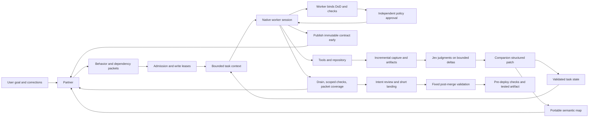
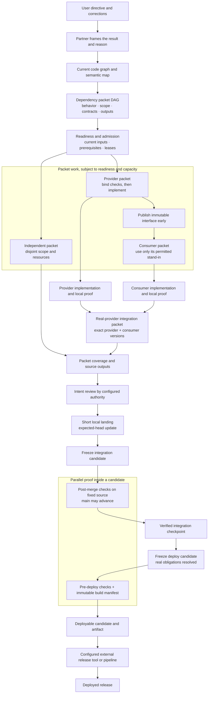

# hx system design

The current packet, repository, and delivery architecture.

hx coordinates parallel agents for general software development: new features, existing
applications, maintenance, integrations, and codebase conversions. Conversion is one use
case. Its additional requirement is source-first understanding: graph the existing codebase
before decomposing conversion work, then keep the source and target repositories in separate
graph namespaces. The Partner concentrates on the existing application's behavior and
dependency structure, traces source responsibilities to target packets, and identifies shared
callees/contracts to implement once and reuse. Harness workers own implementation and proof.
Unknown or dynamic source relationships stay explicit until investigated or validated.

## Runtime path

The Partner understands the application/code graph, owns dependency decomposition,
and schedules maximum useful parallel work within dependencies, ownership/resources, and capacity. Its goal is one paragraph describing the result
and why, with explicit dependency and substitution language. It does not design the
implementation or write the worker's definition of done. Plans represent
that packet as behavior, acceptance obligations, source scope, map inputs, exact
contract/provider versions, shared resources, output obligations, and inherited policy.
The harness worker binds its definition of done and executable checks before editing;
a separately configured reviewer approves the exact binding. Admission validates current inputs and acquires
write and resource leases before work starts. Explicit native launch starts the admitted worker/controller; the root service captures tool and lifecycle events,
and schedules bounded companion passes. Completion drains managed work, validates
receipts and outputs, publishes results, releases leases, and notifies the Partner.
Early contract publication can unlock consumers before the provider packet completes.
Packet coverage retains explicit real-provider obligations; it does not imply deployment
eligibility. [Agent-scale runtime](agent-scale-runtime.md) gives commands and configuration.

## Directive-to-deploy data flow

Every directive follows current code/application dependency evidence, search for existing
capabilities, and reuse before construction. The Partner explores those dependencies,
chooses observable packet boundaries, and schedules maximum useful parallel work within
ownership, resources, source safety, and capacity. Request size does not select packet count.
All assignments use the same packet admission, independent binding, proof, and delivery lifecycle.

The graph uses two kinds of ordering. A hard prerequisite waits for the producer's completed
output and, when it is source, installation proof. A `contract` or permitted `substitutable`
prerequisite can start after the immutable interface is published; the provider can continue
while consumers implement against that exact version. Real-provider integration still waits
for both implementations. Independent packets overlap only when their source snapshots and
write scopes are safe, exclusive resources are free, and host capacity is available. Static
plan waves describe possible parallelism; `ready` and `assign` recheck actual conditions.

| Step | Data passed forward | Available calls and when to use them | Parallelism and gate |
|---|---|---|---|
| 1. Directive and repository orientation | User goal, constraints, corrections; current repository identity and source evidence | Partner uses its native read/search tools for the goal and project instructions. `hx code index --repo …` builds the derived source graph; `hx code fresh … --expect fresh` checks scope freshness. Use `hx code search`, `symbols`, `signature`, `callers`, `tests-for`, `conform`, or `precedent` for bounded code relationships; `hx content search` for indexed documentation. `hx repo file`, `diff`, and `history` retrieve exact content or revision context. For conversions, index the existing source first and keep source and target namespaces separate. | Graph exploration and search/reuse are planning prerequisites for every directive. The graph is candidate evidence; only validated, anchored application-map relationships are trusted as validated dependencies. |
| 2. Decomposition and packet design | A bounded map slice plus dependency, interface, write-scope, and resource relationships becomes versioned packets | `hx map plan-context …` assembles relevant responsibilities, anchors, contracts, checks, owners, and discovery gaps. The Partner decides what can overlap and writes each packet goal as the result, why, dependencies, and allowed stand-in language. `hx plan validate --file …` checks structure and reports waves, width, max parallelism, and interface warnings; `hx plan apply --file …` records the accepted revision. `hx plan unit TASK` reads one assignment. | Plan dependencies set the earliest start; disjoint work scopes, resource declarations, and host slots bound actual concurrency. The Partner defines the packet boundary, not the worker's implementation or definition of done. |
| 3. Admission and source materialization | Frozen source is materialized before a packet receives its admitted run, map versions, and prerequisite proofs | `hx repo assignment TASK …` makes a sparse clean checkout; accept its workdir in the plan before admission. `hx plan ready PLAN` explains which units can start. `hx plan assign TASK --revision … --worker …` rechecks readiness and acquires ownership; `hx launch ID --run RUN --request REQUEST` explicitly advances native startup. `hx repo expand …` adds known files before a tool needs them. Use `hx plan audit RUN` to check that edits stay in the assigned scope. | Separate packets can start in parallel only after admission proves current inputs, clean source, prerequisite readiness, nonconflicting leases, and available capacity. A sparse omission is not evidence that a capability is absent. |
| 4. Worker binding and implementation | The admitted packet becomes an approved worker check binding, then source changes and evidence | Before edits, the worker records its exact checks and obligation coverage with `hx plan bind RUN --file …`; `hx plan binding RUN` reads it; the separately configured reviewer approves the frozen hash with `hx plan approve-binding RUN --binding …`. The worker then uses its configured native read/search/edit/write/shell tools and HX graph/content queries. `hx check CHECK --run RUN` executes a bound check. For .NET, `hx build graph` evaluates the real MSBuild closure, then `hx build build` creates or reuses the immutable build. | Binding and independent approval are a per-packet gate before known mutation/proof operations. Once approved, independent admitted workers can edit concurrently in their own worktrees. |
| 5. Interface-first fan-out | An immutable contract version and its passing contract evidence become a consumer input | Provider: `hx plan publish-contract RUN --output API --file receipts.json`. Consumer: `hx plan acquire-contract CONSUMER --producer PROVIDER --output API --out …`. Use these only for the declared contract/output version; the plan must permit a stand-in. `hx code search` and `hx code signature` let consumers locate and inspect the published interface. | Publication can release consumers before provider implementation finishes. The contract is immutable and versioned; undeclared or unpermitted stand-ins cannot bypass a hard prerequisite. Real-provider verification remains pending. |
| 6. Local proof and packet completion | Changed paths, exact output versions, and run-bound receipts become packet coverage | Run each bound check with `hx check` or the appropriate `hx build test BUILD --run RUN --request … --filter …`; query `hx build status JOB` and recover uncertain jobs with `hx build reconcile JOB`. `hx plan finish RUN --file receipts.json` publishes accepted outputs and releases leases atomically. For the real provider, `hx plan verify-integration …` records the consumer's integration result; `hx plan materialize …` installs exact source outputs for a hard source dependency. | Packet coverage can free workers and unlock the next ready packets. It does not resolve deferred integration or make the change deployable. Matching check artifacts may be reused only when source, environment, tools, fixtures, platform, and declared closure identities match. |
| 7. Intent review and landing | A reviewed intent, source head, and expected integration head become a local landed change | `hx change submit --file …` records the run, base, head, and behavior. `hx change review CHANGE --revision … --decision …` records an independent decision; sensitive boundaries use the configured consequential-change authority. `hx change land CHANGE --repo … --expected-head …` publishes with a short local expected-head update. `hx change status --change …` reads current state. | Review is per change. Landing is serialized at the integration ref; if its head moved, preparation must be repeated against the new head. Local landing does not push remotely. |
| 8. Integration candidate and CI | A fixed merged source snapshot, covered intents, recipes, and test receipts become an integration checkpoint | `hx change candidate --repo … --expected-head … --boundary integration` freezes the candidate; `hx change run-validation BATCH --snapshot …` runs the configured post-merge checks; `hx change status` reports its result. For .NET, matching `hx build build` requests share immutable build output, then `hx build test BUILD` creates private writable test shards without recompiling. | Checks or independent shards can run concurrently within host slots and resource leases. The candidate stays fixed while main advances. This gate validates the merged snapshot, not just each packet's local checks. |
| 9. Deploy candidate and artifact | A verified integration checkpoint, resolved provider obligations, tested build identity, and immutable artifact manifest become deployment evidence | `hx change candidate … --boundary deploy` freezes the release source; `hx change run-validation …` runs configured pre-deploy/build checks and captures configured artifacts; `hx change status` reports `deployable` only when the exact candidate and all obligations pass. `hx handoff delivery …` captures the packet, review, landing, candidate, and proof chain; `hx handoff check … --live` confirms current identities before acting on a handoff. | The deploy boundary requires verified integration for the same source and resolved real-provider obligations. Artifact paths and build manifest are bound to that candidate; a newer main commit does not replace it. |
| 10. External deployment | The deployable candidate and tested artifact are handed to the product's release system | The configured CI/CD job, platform API, or deployment CLI consumes the verified artifact. HX exposes deployability and evidence through its delivery records; it does not provide a universal `hx deploy` command or imply a remote deployment. | This action is downstream of HX's deploy gate. Post-deploy health checks and rollback behavior depend on the product's configured release system. |

Native worker tool names vary by configured harness. The read, search, edit, write, and shell
calls above describe capabilities; HX gates the planned lifecycle and captures observed
events, but arbitrary shell commands are not a filesystem sandbox. The Companion processes
bounded captured deltas and proposes structured task/map updates; it does not execute worker
commands. Jev judges bounded observation and routing candidates, not dependency truth,
absence, or deployment readiness.

Every worker assignment is admitted through the current schema-2 packet plan. Source
materialization and the accepted workdir precede admission. Assignment reserves a run;
`hx launch ID --run RUN --request REQUEST` explicitly starts/reconciles its native controller.
Blockers and corrections become typed progress and accepted plan revisions. Only verified
completion or reconciled stop releases ownership.

## State and application learning

The portable map is checked into the product repository under `.hx/map/`. Records
represent responsibilities, observable behaviors, interfaces, files, resources, and
checks. Their stable semantic IDs are independent of language, framework, directory,
and worker. Records include evidence anchors and source fingerprints; a changed source
invalidates affected records and consumers. Task planning compiles a bounded map slice
into assignment paths, invariants, dependencies, and output obligations. Known check
recipes are suggestions for the worker; inherited verification policy remains required.

Workers do not write a shared map file directly. Runtime discoveries enter scoped
proposals and worktree overlays. Record versions are compared when patches are applied:
identical proposals coalesce, while conflicting writes are rejected. Completion and
integration can publish source-bound findings and bounded retrieval vocabulary into
the portable map. Publication uses a recoverable journal. Fresh clones can reuse the
committed baseline and vocabulary without importing another worker's private state.

The active assignment state contains only information that can help finish that goal:
current constraints, cursor and next action, relevant findings and exact commands,
blockers, unresolved events, checks, and references to useful artifacts. Independent
assignments start from their own goal, current repository/map/configuration, and declared
prerequisites. The runtime can compress or delete obsolete facts and event payloads;
it does not automatically retrieve worker episodes across goals. Raw event streams are
for bounded recovery and evidence retrieval, not routine Partner context.

The SQLite continuity ledger is authoritative for assignments, runs, captured events,
companion passes, map overlays, checkpoints, receipts, leases, and durable publication.
Board, detail, UI, context, and completion project the same task/run identities.
The unreleased product accepts only its current store and packet schemas; obsolete state
is replaced rather than maintained through a compatibility path.

## Companion, Jev, and context control

The companion reads frozen event ranges and scoped evidence, then proposes typed
changes. Deterministic validation checks event identity, task revision, record
versions, evidence references, scope, and source applicability before committing task
state, map updates, and cursors together. Routine passes use deltas rather than loading
whole logs or rewriting complete memory files. Larger current-task reads are reserved
for explicit compaction work.

Jev is a required TypeSafe API dependency. It judges bounded deltas, repeated
observations, optional tool candidates, and surplus command output. It does not select
retained facts, compose prompts, generate memory, plan tasks, or switch models. A Jev
failure does not trigger an alternate inference path. Deterministic checks and the
companion's native model remain responsible for factual changes and task decisions.

Task packets are compiled from current goal state, required records, selected findings,
checks, and unresolved events. Hooks and the root service coordinate token thresholds,
idle boundaries, capture drain, and reset acknowledgement. Native output caps and
autocompaction settings are configured where each adapter exposes them. The companion
prepares state for the reset; it does not write a second narrative summary. Partner
restoration carries current goals and assignments without replaying worker chatter.

Startup prompts keep identity, execution gates, and required reading instructions inline.
Full shared, role, and project instructions live in immutable files named by exact path,
content hash, and byte count. Mandatory assignment context that exceeds its inline budget
uses the same approach through a checkpoint-owned artifact. The agent must read those files
in full before acting; pagination must continue through the end. Required text is never
truncated, and delivering a reference does not prove that the agent read it. Native reads
verify current membership and integrity, and known edit tools cannot mutate these files.
The Companion retains its instructions inline because its tools cannot open arbitrary files.

Tool catalogs allow targeted discovery and loading. Exact known tool IDs bypass
semantic discovery. Required tools stay available. Pi's supported extension API can
update active schemas; launch-only adapters apply expanded selection after checkpointed
restart; advisory adapters provide recipes without claiming to shrink their native
schemas. Tool execution records request identity and bounded output so an uncertain
operation is not silently repeated.

Repository inspection is bounded during normal task work. The runtime caps source reads
and scoped search results, prevents repeating unchanged successful searches within a
checkpoint, reuses small exact search results for unchanged sources, and routes common
large command output through bounded capture. These controls reduce accidental context
and tool-call waste; they do not sandbox arbitrary programs.

## Completion and boundaries

Checks produce receipts tied to commands and declared inputs. Completion requires the
assignment's checks and source outputs to match the current worktree, managed processes
to be drained, and publication to commit before ownership is released. A failed check
keeps the assignment active for repair. Publication replay is idempotent after a crash.

Complete source closures permit scoped fingerprints; unknown closures retain the broad
repository identity. Matching check execution artifacts can be reused across runs, with
a new receipt for the requesting run. Recipe, source, environment, toolchain, fixture,
and external-state identities must all match. Concurrent identical requests share one
execution; recovery verifies process quiescence before releasing the claim.

Review and landing use first-class intent records, independently configured approval
authority, and policy based on the actual change. Merge preparation occurs outside the
publication transaction; moving the local integration ref uses an expected-head check.
Broad integration validation follows landing at a fixed source snapshot. Release checks
name an immutable candidate and the tested build manifest. New commits on main can land
while that validation finishes. Failure evidence names the candidate and implicated
changes so repair or revert can be scheduled without turning the Partner into a reviewer.
No remote push or deployment is implied by local landing.

The implementation does not certify untracked remote jobs or work outside observed
process descendants. Native tool-schema reduction depends on each adapter's public
support. CI, fixtures, and installed SDK checks exercise transport and lifecycle
contracts, but they do not establish general model extraction accuracy. No live native
engineering-to-QA fleet has been run yet.

Verification establishes the exercised transport, lifecycle, and proof boundaries. It does
not establish general model extraction accuracy or imply a live external deployment.

## Search, retrieval, and execution

Code search, graph search, content retrieval, and isolated execution follow
the context-economy contract in [search and retrieval](search-and-retrieval.md):
analysis is programmed (`hx exec`) so only stdout returns, exact content is
retrieved on demand from FTS5 indexes (`hx code`, `hx content`), graph
traversal stays on validated map edges with code-derived candidate edges as
input, and Jev (`hx sift`) only sifts deterministic candidates — it never
establishes absence, validates an edge, or completes a task. These indexes
are rebuildable derived state beside the ledger, not a second authority.

The code graph shares one SQLite store across repository namespaces. Content hashes
refresh source bodies and declaration spans; Python, C#, TypeScript/JavaScript, Go,
Rust, and Software AG Natural have build-free structural extraction. Optional tree-sitter/Universal Ctags
and batch SCIP indexers enrich those facts. Every answer carries its lane, extractor,
source anchor and staleness; ownership is a live join against ledger leases. External
JSONL graphs and published interface contracts share the namespace model. Bounded
`type`, `signature`, `callers`, `register`, `tests-for`, `conform`, and `precedent`
queries let a worker establish reuse and exact source locations before proposing code.
Natural extraction follows exported object types, public function/subroutine names,
parameter declarations, and literal call/dependency targets. Dynamic operands remain
reference sites without static call edges. Source spans preserve physical listing
lines for application-map anchors; see
[Natural source support](search-and-retrieval.md#natural-source-support)
for supported formats and query examples.

Plan validation and admission check the indexed base and hashes for allowed writes.
A missing derived cache is built automatically. Immutable snapshots bind repository,
commit, overlay, and extractor generation; different checkouts and revisions coexist.
Compressed source and extraction objects are shared by content identity, with persistent
path maps and indexed postings for named queries. `--at COMMIT` selects an immutable
revision; dirty overlays never claim clean-commit identity. A
changed scope in the indexed checkout refuses admission and names the rebuild command.
Completion publishes changed paths in its durable result and refreshes those paths;
replaying publication retries the same refresh after interruption. Scoped refresh
invalidates dependent candidates. The installed `bin/code-index-post-merge` performs
the post-merge refresh. Durable changesets contain parent/new identities, exact changed
paths, modes, blobs, and deletions. Parsing precedes short publication transactions;
replay resumes interrupted publication. No graph state is written into a product checkout.
PageRank orientation and Louvain decomposition remain deterministic candidate output;
only the existing application-map validation path can promote a proposal.

Instances can configure one host repository service over a Unix socket. The existing
CLI then shares immutable graph/source objects and bounded metadata queries across
instances. Diff, ancestry, history, and file-range jobs need no client checkout. Ownership
continues to come from the requesting instance's live ledger. Sparse materialization
shares Git objects while writing only selected source paths in a fresh directory.

For .NET, `hx build` evaluates projects and dependencies with MSBuild, fingerprints
SDK/package/import/build configuration, deduplicates matching requests, and bounds host
build concurrency. Immutable build artifacts are copied into private writable test
state; shards use the build without compiling again. Unsupported or incomplete build
closures are reported explicitly and do not qualify for reusable proof.

## Related contracts

- [Search and retrieval](search-and-retrieval.md)
- [Application map](application-map.md)
- [Planning runtime](planning-runtime.md)
- [Agent-scale runtime](agent-scale-runtime.md)
- [Prompt runtime](prompt-runtime.md)
