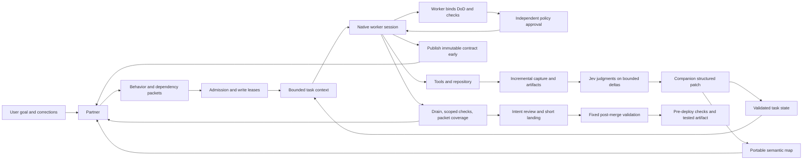

# hx system design

Current system behavior and remaining integration work.

hx coordinates parallel agents for general software development: new features, existing
applications, maintenance, integrations, and codebase conversions. Conversion is one use
case. Its additional requirement is source-first understanding: graph the existing codebase
before decomposing conversion work, then keep the source and target repositories in separate
graph namespaces. The Partner concentrates on the existing application's behavior and
dependency structure, traces source responsibilities to target packets, and identifies shared
callees/contracts to implement once and reuse. Harness workers own implementation and proof.
Unknown or dynamic source relationships stay explicit until investigated or validated.

## Runtime path

The Partner understands the application/code graph, owns dependency decomposition,
and schedules work that can overlap. Its goal is one paragraph describing the result
and why, with explicit dependency and substitution language. It does not design the
implementation or write the worker's definition of done. Version-2 plans represent
that packet as behavior, acceptance obligations, source scope, map inputs, exact
contract/provider versions, shared resources, output obligations, and inherited policy.
The harness worker binds its definition of done and executable checks before editing;
a separately configured reviewer approves the exact binding. Version-1 plans retain
their existing explicit-check contract. Admission validates current inputs and acquires
write and resource leases before work starts. The
runtime starts the native worker and root service, captures tool and lifecycle events,
and schedules bounded companion passes. Completion drains managed work, validates
receipts and outputs, publishes results, releases leases, and notifies the Partner.
Early contract publication can unlock consumers before the provider packet completes.
Packet coverage retains explicit real-provider obligations; it does not imply deployment
eligibility. [Agent-scale runtime](agent-scale-runtime.md) gives commands and configuration.

## State and application learning

The portable map is checked into the product repository under `.hx/map/`. Records
represent responsibilities, observable behaviors, interfaces, files, resources, and
checks. Their stable semantic IDs are independent of language, framework, directory,
and worker. Records include evidence anchors and source fingerprints; a changed source
invalidates affected records and consumers. Task planning compiles a bounded map slice
into assignment paths, invariants, dependencies, and output obligations. Known check
recipes are suggestions for the worker; inherited verification policy remains required.

Workers do not write a shared map file directly. Runtime discoveries enter scoped
proposals and worktree overlays. Record versions are compared when patches are applied:
identical proposals coalesce, while conflicting writes are rejected. Completion and
integration can publish source-bound findings and bounded retrieval vocabulary into
the portable map. Publication uses a recoverable journal. Fresh clones can reuse the
committed baseline and vocabulary without importing another worker's private state.

The active assignment state contains only information that can help finish that goal:
current constraints, cursor and next action, relevant findings and exact commands,
blockers, unresolved events, checks, and references to useful artifacts. Independent
assignments start from their own goal, current repository/map/configuration, and declared
prerequisites. The runtime can compress or delete obsolete facts and event payloads;
it does not automatically retrieve worker episodes across goals. Raw event streams are
for bounded recovery and evidence retrieval, not routine Partner context.

The SQLite continuity ledger is authoritative for its explicit planned-run path. It
tracks assignments, runs, captured events, companion passes, map overlays, checkpoints,
receipts, leases, and durable publication work. Legacy work-item and projection
consumers have not all migrated together yet; the coordinated authority cutover remains
open. Do not treat the existence of a ledger command as proof that every installed
instance uses the ledger for all task state.

## Companion, Jev, and context control

The companion reads frozen event ranges and scoped evidence, then proposes typed
changes. Deterministic validation checks event identity, task revision, record
versions, evidence references, scope, and source applicability before committing task
state, map updates, and cursors together. Routine passes use deltas rather than loading
whole logs or rewriting complete memory files. Larger current-task reads are reserved
for explicit compaction work.

Jev is a required TypeSafe API dependency. It judges bounded deltas, repeated
observations, optional tool candidates, and surplus command output. It does not select
retained facts, compose prompts, generate memory, plan tasks, or switch models. A Jev
failure does not trigger an alternate inference path. Deterministic checks and the
companion's native model remain responsible for factual changes and task decisions.

Task packets are compiled from current goal state, required records, selected findings,
checks, and unresolved events. Hooks and the root service coordinate token thresholds,
idle boundaries, capture drain, and reset acknowledgement. Native output caps and
autocompaction settings are configured where each adapter exposes them. The companion
prepares state for the reset; it does not write a second narrative summary. Partner
restoration carries current goals and assignments without replaying worker chatter.

Tool catalogs allow targeted discovery and loading. Exact known tool IDs bypass
semantic discovery. Required tools stay available. Pi's supported extension API can
update active schemas; launch-only adapters apply expanded selection after checkpointed
restart; advisory adapters provide recipes without claiming to shrink their native
schemas. Tool execution records request identity and bounded output so an uncertain
operation is not silently repeated.

Repository inspection is bounded during normal task work. The runtime caps source reads
and scoped search results, prevents repeating unchanged successful searches within a
checkpoint, reuses small exact search results for unchanged sources, and routes common
large command output through bounded capture. These controls reduce accidental context
and tool-call waste; they do not sandbox arbitrary programs.

## Completion and boundaries

Checks produce receipts tied to commands and declared inputs. Completion requires the
assignment's checks and source outputs to match the current worktree, managed processes
to be drained, and publication to commit before ownership is released. A failed check
keeps the assignment active for repair. Publication replay is idempotent after a crash.

Complete source closures permit scoped fingerprints; unknown closures retain the broad
repository identity. Matching check execution artifacts can be reused across runs, with
a new receipt for the requesting run. Recipe, source, environment, toolchain, fixture,
and external-state identities must all match. Concurrent identical requests share one
execution; recovery verifies process quiescence before releasing the claim.

Review and landing use first-class intent records, independently configured approval
authority, and policy based on the actual change. Merge preparation occurs outside the
publication transaction; moving the local integration ref uses an expected-head check.
Broad integration validation follows landing at a fixed source snapshot. Release checks
name an immutable candidate and the tested build manifest. New commits on main can land
while that validation finishes. Failure evidence names the candidate and implicated
changes so repair or revert can be scheduled without turning the Partner into a reviewer.
No remote push or deployment is implied by local landing.

The implementation does not certify untracked remote jobs or work outside observed
process descendants. Native tool-schema reduction depends on each adapter's public
support. CI, fixtures, and installed SDK checks exercise transport and lifecycle
contracts, but they do not establish general model extraction accuracy. No live native
engineering-to-QA fleet has been run yet.

The remaining legacy integration gaps are the coordinated migration of legacy
state authorities/projections and retention of the minimal state needed to resume a
cancelled assignment. Optional QA triage and test selection remain follow-on features.
The current status document tracks these boundaries and verification details.

## Search, retrieval, and execution

Code search, graph search, content retrieval, and isolated execution follow
the context-economy contract in [search and retrieval](search-and-retrieval.md):
analysis is programmed (`hx exec`) so only stdout returns, exact content is
retrieved on demand from FTS5 indexes (`hx code`, `hx content`), graph
traversal stays on validated map edges with code-derived candidate edges as
input, and Jev (`hx sift`) only sifts deterministic candidates — it never
establishes absence, validates an edge, or completes a task. These indexes
are rebuildable derived state beside the ledger, not a second authority.

The code graph shares one SQLite store across repository namespaces. Content hashes
refresh source bodies and declaration spans; Python, C#, TypeScript/JavaScript, Go,
Rust, and Software AG Natural have build-free structural extraction. Optional tree-sitter/Universal Ctags
and batch SCIP indexers enrich those facts. Every answer carries its lane, extractor,
source anchor and staleness; ownership is a live join against ledger leases. External
JSONL graphs and published interface contracts share the namespace model. Bounded
`type`, `signature`, `callers`, `register`, `tests-for`, `conform`, and `precedent`
queries let a worker establish reuse and exact source locations before proposing code.
Natural extraction follows exported object types, public function/subroutine names,
parameter declarations, and literal call/dependency targets. Dynamic operands remain
reference sites without static call edges. Source spans preserve physical listing
lines for application-map anchors; see
[Natural source support](search-and-retrieval.md#natural-source-support)
for supported formats and query examples.

Plan validation and admission check the indexed base and hashes for allowed writes.
A missing derived cache is built automatically. Immutable snapshots bind repository,
commit, overlay, and extractor generation; different checkouts and revisions coexist.
Compressed source and extraction objects are shared by content identity, with persistent
path maps and indexed postings for named queries. `--at COMMIT` selects an immutable
revision; dirty overlays never claim clean-commit identity. A
changed scope in the indexed checkout refuses admission and names the rebuild command.
Completion publishes changed paths in its durable result and refreshes those paths;
replaying publication retries the same refresh after interruption. Scoped refresh
invalidates dependent candidates. The installed `bin/code-index-post-merge` performs
the post-merge refresh. Durable changesets contain parent/new identities, exact changed
paths, modes, blobs, and deletions. Parsing precedes short publication transactions;
replay resumes interrupted publication. No graph state is written into a product checkout.
PageRank orientation and Louvain decomposition remain deterministic candidate output;
only the existing application-map validation path can promote a proposal.

Instances can configure one host repository service over a Unix socket. The existing
CLI then shares immutable graph/source objects and bounded metadata queries across
instances. Diff, ancestry, history, and file-range jobs need no client checkout. Ownership
continues to come from the requesting instance's live ledger. Sparse materialization
shares Git objects while writing only selected source paths in a fresh directory.

For .NET, `hx build` evaluates projects and dependencies with MSBuild, fingerprints
SDK/package/import/build configuration, deduplicates matching requests, and bounds host
build concurrency. Immutable build artifacts are copied into private writable test
state; shards use the build without compiling again. Unsupported or incomplete build
closures are reported explicitly and do not qualify for reusable proof.

## Related contracts

- [Search and retrieval](search-and-retrieval.md)
- [Application map](application-map.md)
- [Continuity runtime](continuity-runtime.md)
- [Planning runtime](planning-runtime.md)
- [Agent-scale runtime](agent-scale-runtime.md)
- [Prompt runtime](prompt-runtime.md)
- [Build status and verification](continuity-build-status.md)
- [Native interface verification](native-interface-verification.md)
